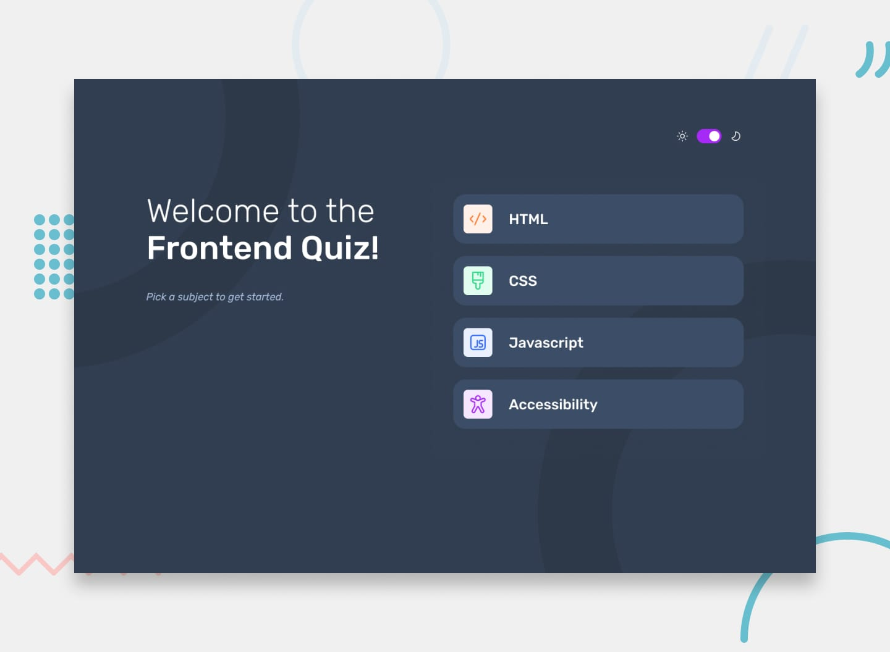

# Frontend Mentor — решение челленджа «Frontend quiz app»

Это решение [челленджа «Frontend quiz app» на Frontend Mentor](https://www.frontendmentor.io/challenges/frontend-quiz-app-BE7xkzXQnU). Челленджи Frontend Mentor помогают прокачивать навыки программирования на реалистичных проектах.

## Содержание

- [Обзор](#обзор)
  - [Задача](#задача)
  - [Скриншот](#скриншот)
  - [Ссылки](#ссылки)
- [Мой процесс](#мой-процесс)
  - [Стек технологий](#стек-технологий)
  - [Чему я научился](#чему-я-научился)

## Обзор

Проект находится в разработке. Подготовлены инструменты, дизайн-токены и базовые стили; подключены локальные шрифты Rubik. Интерфейс и логика квиза пока не реализованы.

### Задача

Пользователи должны иметь возможность:

- Выбрать тему квиза
- Выбрать один ответ на каждый вопрос из четырёх вариантов
- Увидеть сообщение об ошибке, если пытаются отправить ответ, ничего не выбрав
- Увидеть, правильный или неправильный ответ они дали, после отправки
- Перейти к следующему вопросу после того, как увидят результат
- Увидеть экран завершения со счётом после последнего вопроса
- Сыграть снова и выбрать другую тему
- Видеть оптимальную раскладку интерфейса в зависимости от размера экрана устройства
- Видеть состояния hover и focus у всех интерактивных элементов на странице
- Пользоваться всем приложением только с клавиатуры
- **Бонус**: переключать тему приложения между светлой и тёмной

### Скриншот

### Ссылки

- Рабочая версия сайта: [vimanshin.github.io/frontend-quiz-app](https://vimanshin.github.io/frontend-quiz-app)

## Мой процесс

### Стек технологий

- HTML5
- SCSS
- TypeScript без фреймворков
- Vite

### Чему я научился
