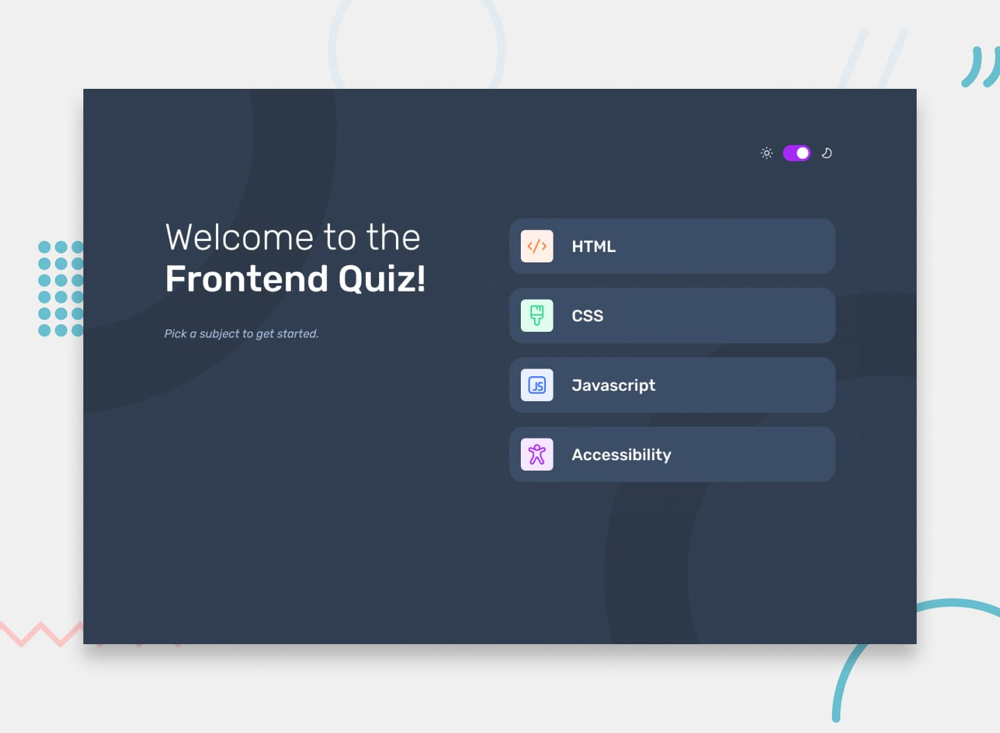

# Frontend Mentor — решение челленджа «Frontend quiz app»

Это решение [челленджа «Frontend quiz app» на Frontend Mentor](https://www.frontendmentor.io/challenges/frontend-quiz-app-BE7xkzXQnU). Челленджи Frontend Mentor помогают прокачивать навыки программирования на реалистичных проектах.

## Содержание

- [Обзор](#обзор)
  - [Задача](#задача)
  - [Скриншот](#скриншот)
  - [Ссылки](#ссылки)
- [Локальный запуск и проверка](#локальный-запуск-и-проверка)
- [Публикация на GitHub Pages](#публикация-на-github-pages)
- [Мой процесс](#мой-процесс)
  - [Стек технологий](#стек-технологий)
  - [Чему я научился](#чему-я-научился)

## Обзор

Адаптивный квиз по четырём темам: HTML, CSS, JavaScript и Accessibility. В каждой теме десять вопросов. `Submit Answer` фиксирует выбор и показывает обратную связь; `Next Question` открывает следующий вопрос. После последнего ответа `Show Results` показывает счёт, а `Play Again` возвращает к выбору темы. Светлое и тёмное оформление можно переключать в любой момент без сброса ответов; после перезагрузки страница снова открывается в светлой теме.

### Задача

Пользователи должны иметь возможность:

- Выбрать тему квиза
- Выбрать один ответ на каждый вопрос из четырёх вариантов
- Увидеть сообщение об ошибке, если пытаются отправить ответ, ничего не выбрав
- Увидеть, правильный или неправильный ответ они дали, после отправки
- Перейти к следующему вопросу после того, как увидят результат
- Увидеть экран завершения со счётом после последнего вопроса
- Сыграть снова и выбрать другую тему
- Видеть оптимальную раскладку интерфейса в зависимости от размера экрана устройства
- Видеть состояния hover и focus у всех интерактивных элементов на странице
- Пользоваться всем приложением только с клавиатуры
- **Бонус**: переключать тему приложения между светлой и тёмной

### Скриншот



### Ссылки

- Адрес для публикации: [vimanshin.github.io/frontend-quiz-app](https://vimanshin.github.io/frontend-quiz-app). До первого успешного развёртывания ссылка может возвращать 404.

## Локальный запуск и проверка

Нужны Node.js 24 или новее и npm. Из корня репозитория:

```sh
npm ci
npm run dev
```

Открой адрес, который выведет Vite. `npm run check` проверяет форматирование, SCSS, TypeScript-код и типы, затем собирает приложение в `dist/`. Для проверки именно сборки запусти `npm run preview` после успешного `check`. Если нужна только проверка типов и сборка, используй `npm run build`.

## Публикация на GitHub Pages

1. Убедись, что `.github/workflows/pages.yml` и код сайта отправлены в основную ветку `main` на GitHub. Каталог `dist/` коммитить не нужно.
2. В репозитории открой **Settings → Pages → Build and deployment → Source** и выбери **GitHub Actions**.
3. Когда будешь готов опубликовать сайт, открой **Actions → Deploy quiz to GitHub Pages → Run workflow**, выбери `main` и запусти задачу. Обычный push этот процесс не запускает.
4. После успешных шагов `build` и `deploy` открой адрес из раздела «Ссылки». Workflow публикует только проверенный `dist/`; относительные пути ресурсов позволяют раздавать его из `/frontend-quiz-app/`.

## Мой процесс

### Стек технологий

- HTML5
- SCSS
- TypeScript без фреймворков
- Vite

### Чему я научился

Отделять состояние квиза от его оформления, вычислять прогресс по подтверждённым ответам и переносить клавиатурный фокус при переходе между вопросом, результатом и меню.
